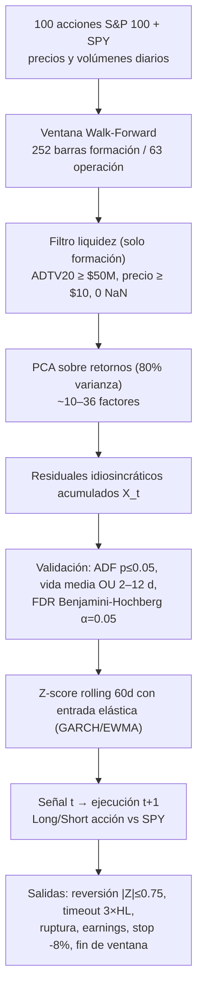

# Informe Integral — Estrategia PCA Híbrida (Stat Arb S&P 100)

**Rama:** `exp-cerrar-distancia-pares-definidos` · **Código:** [`run_pipeline.py`](../run_pipeline.py) → `run_trading_pipeline()` · **Fecha:** 2026-11-01

> [!IMPORTANT]
> **Lectura honesta en una línea:** el sistema está técnicamente completo y libre de look-ahead, pero **los resultados NO demuestran una ventaja estadística**. A 10 años pierde; a 5 años gana, pero con 22 operaciones y t-stat 1.42. Además, la "cobertura" contra SPY es en la práctica ~10% del nocional (ver §6). Este informe corrige el tono optimista de informes previos.

---

## 1. Idea de la estrategia (en simple)

Cada acción se mueve por dos cosas: (1) **factores comunes** (mercado, sectores) y (2) **ruido propio** (idiosincrásico). Si el ruido propio tiende a volver a cero (reversión a la media), cuando una acción se aleja demasiado de lo que "deberían" explicar los factores, se apuesta a que regresa.

Base teórica: *Avellaneda & Lee (2010)*, Statistical Arbitrage in the U.S. Equities Market.

---

## 2. Especificación técnica

| Componente | Configuración |
| :--- | :--- |
| Universo | 99 tickers S&P 100 (BK sin datos en Yahoo) + SPY como proxy |
| Datos | Yahoo Finance, ajustados; caché `data/sp100_prices_10y.csv` (gitignored) |
| Walk-Forward | 252 in-sample / 63 out-of-sample / paso 63 (sin solapamiento OOS) |
| Liquidez | ADTV 20d ≥ \$50M, precio ≥ \$10, historial completo in-sample |
| PCA | `variance_threshold=0.80`, SVD sobre retornos estandarizados |
| Validación | ADF p ≤ 0.05; OU half-life ∈ [2, 12] días; FDR-BH α = 0.05 |
| Señal | Entrada \|Z\| ≥ 2.0 (elástica por vol condicional); **salida \|Z\| ≤ 0.75** |
| Stops de señal | `stop_half_life` (tiempo > 3×HL), `stop_structural_break` (corr < 0.10) |
| Riesgo | Hard stop −8% del nocional; cuarentena earnings 3 días; evacuación a t−1 |
| Costos | Comisión 1.5 bps, bid-ask 3 bps, impacto 0.05·√participación, borrow 2% anual |
| Ejecución | Señal en cierre t → fill en t+1 |
| Capital | \$100,000 por activo simulado, apalancamiento bruto 1.0 |
| Patas | Pata A: 100% del capital en la acción · Pata B: SPY opuesto × β_eff |

**Evolución de hiperparámetros (ADR 011→013):**

| Config | Var. PCA | Max HL | Exit Z | Resultado (2021-25, 15 vent.) |
| :--- | :---: | :---: | :---: | :--- |
| Base | 0.80 | 30 | 0.50 | −0.10% / Sharpe −0.03 |
| Optimizada | 0.87 | 12 | 0.75 | −31.3% acum. trades, PF 0.26 (sobreajuste, 47 factores) |
| **Híbrida (oficial)** | **0.80** | **12** | **0.75** | **+0.68% / Sharpe 0.16** |

---

## 3. Resultados — tres horizontes

| Métrica | 10 años (2015–25) | 7 años (2018–25) | 5 años (2020–25) |
| :--- | :---: | :---: | :---: |
| Barras / ventanas WF | 2,765 / 39 | 2,010 / 27 | 1,507 / 19 |
| Ventanas con trading | 14 (36%) | 10 (37%) | 7 (37%) |
| Trades | 38 | 31 | 22 |
| Win rate | 39.5% | 51.6% | 59.1% |
| Ganancia / pérdida media | +2.51% / −2.06% | +3.57% / −3.46% | +4.69% / −3.09% |
| Profit factor | 0.80 | 1.10 | 2.19 |
| PnL neto | **−\$10,676** | **+\$5,932** | **+\$35,596** |
| Suma de retornos de trades¹ | −9.67% | +5.17% | +33.13% |
| Retorno medio / trade | −0.25% | +0.17% | +1.51% |
| Desv. est. / trade | 2.86% | 4.78% | 4.98% |
| **t-stat del retorno medio²** | **−0.54** | **+0.20** | **+1.42** |
| Sharpe medio por ventana³ | −0.46 | +0.12 | +0.51 |
| Peor DD de una ventana | −9.54% | −17.54% | −10.74% |
| Duración media | 12.3 d | 12.1 d | 11.0 d |
| Fricciones (comis.+borrow) | \$2,176 | \$1,565 | \$1,086 |

¹ Suma simple, **no compuesta**; cada trade se simula con capital propio. ² t = media / (σ/√n). Ninguno supera |2|. ³ Promedio de Sharpes calculados dentro de cada ventana de 63 días: no es el Sharpe anualizado de una cartera.

### 3.1 PnL por año de entrada (\$)

| Año | 10 años | 7 años | 5 años |
| :--- | ---: | ---: | ---: |
| 2016 | −7,870 | — | — |
| 2017 | −3,264 | — | — |
| 2018 | +7,485 | — | — |
| 2019 | −4,719 | −21,680 | — |
| 2020 | −1,647 | +1,584 | — |
| 2021 | +6,766 | +5,681 | +6,505 |
| 2022 | −4,311 | +16,754 | +18,757 |
| 2023 | — | −9,957 | — |
| 2024 | +2,106 | — | +6,407 |
| 2025 | −5,222 | +13,550 | +3,926 |

Observación: **2022 y 2025 explican casi todo el PnL de 5 y 7 años.** Los mismos eventos (p. ej. GOOG/GOOGL en ene–feb 2025) se repiten en los tres horizontes.

### 3.2 Motivos de salida

| Salida | 10 años | 7 años | 5 años |
| :--- | :---: | :---: | :---: |
| `mean_reversion` | 9 (+\$5,043) | 10 (+\$16,646) | 8 (+\$20,120) |
| `stop_half_life` | 10 (−\$5,514) | 5 (+\$6,189) | 5 (+\$30,574) |
| `FORCE_EXIT_EARNINGS` | 10 (−\$6,780) | 6 (+\$25,834) | 3 (+\$9,944) |
| `end_of_period` | 5 (+\$1,825) | 7 (−\$18,308) | 5 (−\$16,252) |
| `stop_loss_8pct` | 0 | 2 (−\$19,685) | 1 (−\$8,791) |
| `stop_structural_break` | 4 (−\$5,250) | 1 (−\$4,744) | 0 |

### 3.3 Dirección y patas (5 años)

- LONG_SPREAD: 12 trades, +\$5,039 · SHORT_SPREAD: 10 trades, **+\$30,557**.
- PnL pata acción: +\$36,326 · PnL pata SPY: +\$357 → **prácticamente todo el resultado viene de la acción sola.**

### 3.4 Activos destacados

- **5 años:** GOOG/GOOGL +\$14,667, NEE +\$8,432, CMCSA +\$8,111, TMO +\$6,547, IBM +\$6,407. Peor: **T −\$10,741**, JNJ −\$5,253.
- **10 años:** MS +\$12,122, ABT +\$6,766, NEE +\$4,683. Peores: MO −\$5,750, T −\$4,702, JNJ −\$4,492.

---

## 4. Controles contra sesgos (verificado)

- Sin look-ahead: medias, desvíos, autovectores y betas congelados in-sample; Z-score con cola in-sample de 60 barras.
- Ejecución en t+1 (test `test_t_plus_one_execution_rule`).
- Costos completos descontados por trade (comisión, spread, impacto, borrow).
- FDR-BH controla falsos descubrimientos entre ~95 residuales por ventana.
- Suite de pruebas: **44/44 pasan**.

---

## 5. Experimentos relacionados

| Experimento | Resultado |
| :--- | :--- |
| Pares fijos (KO/PEP, V/MA, CVX/XOM, HD/LOW, UNP/CSX) | Solo CVX/XOM pasó FDR; 2 trades, +\$323 |
| Fortress-200 (30 defensivas, top-200 SSD) | 0 pares pasan FDR (mín p = 0.00051 vs umbral 0.00025) → 0 trades |
| Semis bivariado (Top-20 SSD) | 9 trades, −\$1,446 |

---

## 6. Limitaciones y hallazgos críticos

> [!WARNING]
> **1. La cobertura de mercado es casi inexistente.** El hedge usa β_total = Σβ_{i,k} sobre factores PCA ortonormales de media cero; esa suma **no es un beta de mercado** (su signo es arbitrario). Valor medio observado: |β| ≈ 0.003–0.008, por lo que el código aplica el piso `max(|β|, 0.1)` → **la pata SPY es ≈10% del nocional de la acción.** La estrategia es en la práctica una apuesta direccional en una sola acción con un hedge parcial. Llamarla "market-neutral" es incorrecto con la implementación actual.

> [!WARNING]
> **2. Sin significancia estadística.** t-stats de −0.54 / +0.20 / +1.42 con 22–38 trades. Los tres horizontes comparten trades y los resultados dependen del alineamiento de ventanas (cambiar `start_date` mueve todas las ventanas), por lo que **no son evidencia independiente**. El "alfa creciente en los últimos años" es compatible con ruido y con dos o tres episodios (2022, GOOG/GOOGL 2025).

> [!WARNING]
> **3. Sesgo de supervivencia.** La lista del S&P 100 es la actual; acciones que salieron del índice o quebraron entre 2015 y 2025 no están. Infla resultados históricos.

**Otras limitaciones**
4. Cada activo se simula con \$100k propios; no hay cartera ni curva de capital conjunta, así que no existe Sharpe/Drawdown de cartera real. El DD reportado es el peor de una ventana individual.
5. Calendario de earnings **sintético** (`generate_synthetic_schedule`), no fechas reales.
6. Borrow fee plano de 2% (acciones "hard-to-borrow" costarían más). Sin dividendos en cortos.
7. Un trade (`CVX 2016-09-30`) dura 0 días: artefacto de fin de ventana.
8. Cerca de 64% de las ventanas no operan: el capital queda ocioso (sin rendimiento de caja).
9. `end_of_period` fuerza cierres artificiales (−\$16k en 5 años) por la partición trimestral.

---

## 7. Veredicto y próximos pasos recomendados

**Veredicto:** infraestructura sólida y metodología correcta; **ventaja explotable no demostrada**. No debe presentarse como "configuración de producción" lista para capital real.

Prioridad sugerida (de mayor a menor impacto):
1. **Corregir el hedge:** estimar β de mercado real (regresión de cada acción contra SPY in-sample) o hedgear con ETFs sectoriales; verificar que el PnL de la pata SPY compense.
2. **Simulación de cartera:** operar todos los residuales aprobados simultáneamente con un único capital y calcular Sharpe, drawdown y retorno anualizado reales.
3. **Universo sin sesgo de supervivencia** (constituyentes históricos) y fechas de earnings reales.
4. **Contrastes de robustez:** variar `start_date` y `exit_z` en rejilla, bootstrap de retornos de trades, y exigir t > 2 antes de concluir.
5. Permitir que las posiciones crucen el límite de ventana en lugar de forzar `end_of_period`.

Archivos de datos: `results/walk_forward_pca_sp100_{10,7,5}years.*`, `results/trades_pca_sp100_{10,7,5}years.csv`, auditorías `*_candidates_audit.csv`. ADRs: 011–015 en [`docs/decisions.md`](../docs/decisions.md).
